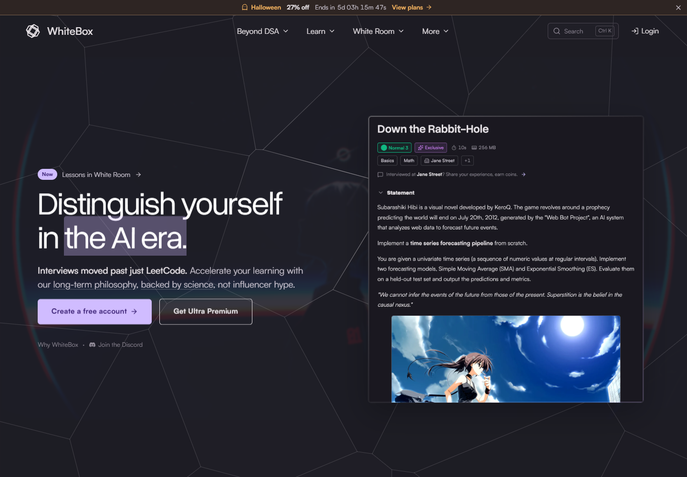
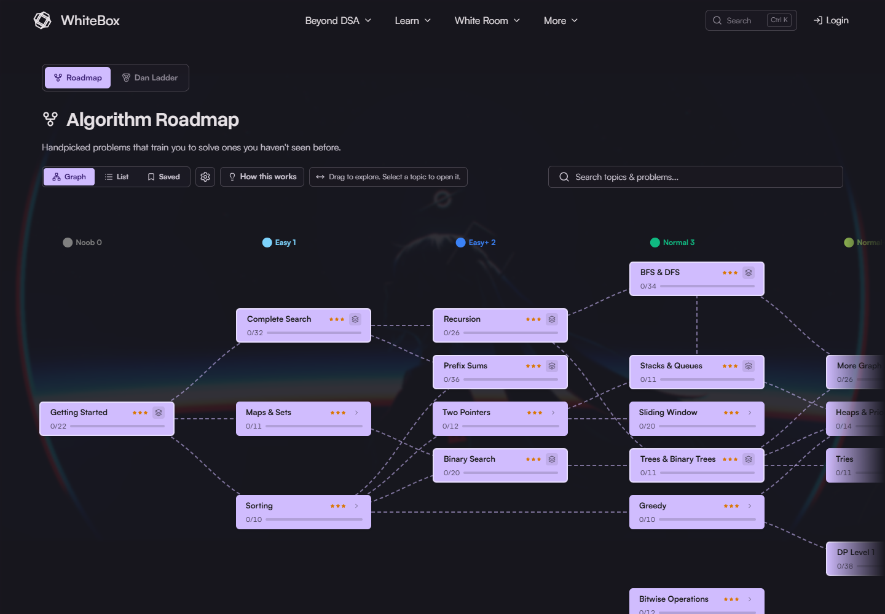
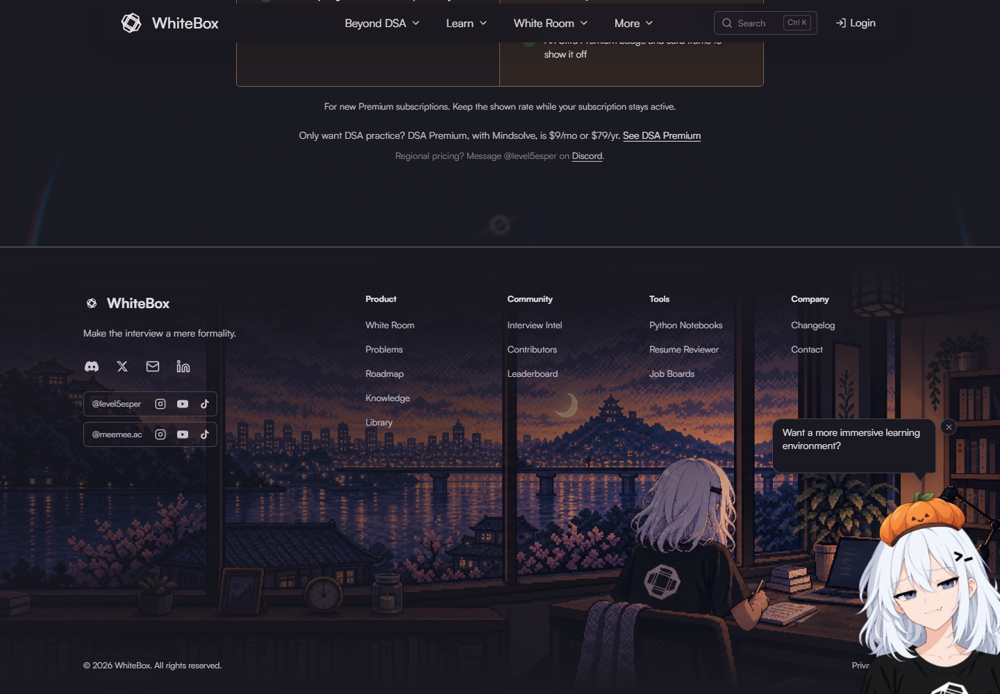
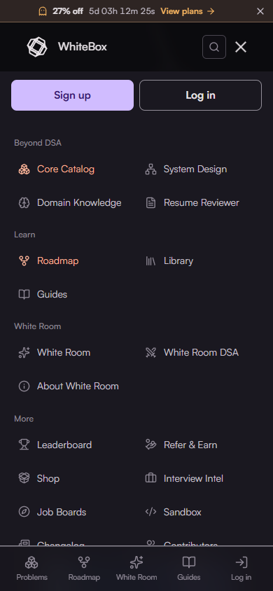

# Whitebox design inspiration for EvalForge

Inspected on 4 November 2026. Reference: [Whitebox](https://whitebox.ac/). Target: this EvalCode repository, whose UI is branded EvalForge.

## Recommendation

Give EvalForge a more expressive homepage through a geometric backdrop, lighter display typography, a stronger product demonstration, and an original illustrated footer. Carry the same precision into navigation and catalogs. Keep the active code-review environment calm and readable.

Whitebox's identity comes from the relationship between its atmosphere, product previews, and learning visualizations. Copying the purple accent alone would miss most of what makes the site distinctive.

This is an inspiration inventory and bounded visual review of public surfaces. It is not a complete audit of every Whitebox feature or its authenticated application.

## Inspection and evidence

The connected browser was unavailable. After the user explicitly approved local Playwright, inspection used Chromium at 1440 × 1000 and a touch-enabled phone context at 390 × 844. Screenshots were saved and opened for visual review. Whitebox's public HTML and CSS supplied implementation details; EvalForge's current source and fresh local renders supplied comparison context.

| Step | Surface and evidence | General health / finding |
| --- | --- | --- |
| 1 | [Desktop hero](screenshots/01-home-desktop.png), [pointer hover](screenshots/01b-home-hero-hover.png) | Strong identity and clear focal points. Pointer-driven preview tilt works. Background geometry crosses behind text, so contrast needs care. |
| 2 | [Desktop navigation](screenshots/02-desktop-navigation.png), [command search](screenshots/03-command-search.png) | Descriptive navigation and search create useful entry points. Hover opening, search opening, and Escape dismissal were exercised; complete keyboard behavior was not audited. |
| 3 | [Homepage coding preview](screenshots/04-product-tour.png), [White Room showcase](screenshots/17-white-room-desktop.png) | Substantial product evidence. Clicking the homepage White Room tab changed the tour content. Demo interactivity does not establish that the underlying service works. |
| 4 | [Homepage roadmap](screenshots/05-roadmap-home.png), [full roadmap](screenshots/15-roadmap-desktop.png), [after dragging](screenshots/22-roadmap-panned.png) | Memorable and explorable. Horizontal dragging changed the roadmap scroll position from 0 to 720. The actual roadmap route is `/algorithms`. |
| 5 | [Feature modules](screenshots/06-feature-modules.png), [selectable feed](screenshots/07-interview-intel.png), [selected preview](screenshots/21-selected-problem-preview.png) | Distinctive explanatory graphics and clear selection feedback. Selecting Hashring changed the detail panel to the matching problem. The floating character overlaps content in some broad-run captures. |
| 6 | [Sample report](screenshots/08-sample-results.png), [learning evidence](screenshots/09-learning-evidence.png) | Concrete output and explanation are more persuasive than feature slogans. The report is explicitly labeled as a sample. Chart claims and scoring validity were not independently evaluated. |
| 7 | [Pricing](screenshots/10-pricing.png), [footer](screenshots/11-illustrated-footer.png) | Clear visual hierarchy; the illustrated footer is especially memorable. Seasonal treatment is temporary, and a floating character competes with nearby content. No checkout was attempted. |
| 8 | [Phone hero](screenshots/12-home-mobile.png), [phone roadmap](screenshots/13-roadmap-mobile.png), [phone menu](screenshots/23-mobile-navigation.png), [phone catalog](screenshots/24-mobile-catalog.png) | Layout changes substantially for touch. Persistent bottom navigation is useful; tiny scaled preview text and a wide graph are less readable. Desktop and phone homepage document widths matched their viewports; the phone catalog also had no document overflow. |
| 9 | [Desktop catalog](screenshots/14-catalog-desktop.png), [guide reader](screenshots/16-guides-desktop.png) | Compact browsing and a deliberately different reading layout. Dense metadata and multiple sidebars need responsive care. Guide navigation redirected to the introductory article. |
| 10 | [Current EvalForge desktop](screenshots/18-evalforge-current-desktop.png), [current phone](screenshots/19-evalforge-current-mobile.png) | A working review sample, clear first action, restrained surfaces, and readable mobile stacking already exist. The biggest opportunity is more character and better demonstration below the hero. |

### Representative captures

Desktop hero:

Roadmap:

Illustrated footer:

Mobile navigation:

## Reusable design inventory

P1 = strongest first implementation candidates. P2 = useful follow-up. P3 = conditional or requires additional product work. Effort is relative: S = a localized styling/component change, M = several components or meaningful interaction work, L = a larger feature or original asset work. These are planning estimates, not delivery promises.

| # | Observed design | Adaptation for EvalForge | Priority / effort |
| --- | --- | --- | --- |
| 1 | A dark canvas with a subtle plum cast | Introduce a slightly richer marketing canvas while maintaining clear code/editor separation. Start by testing it alongside our existing mint accent. | P2 / S |
| 2 | Lavender primary actions and a peach secondary accent | Borrow disciplined color roles. Our mint can continue to identify actions; reserve amber/red for real feedback and warnings. A full palette replacement would be a separate design decision. | P1 / S |
| 3 | Oversized, relatively light grotesk headlines | Try lighter marketing headings with tighter tracking and deliberate line breaks. Keep code and small UI text comfortably readable. | P1 / S |
| 4 | Fluid type, broad gutters, generous section spacing | Give the homepage a clearer rhythm and more deliberate section proportions. Use smaller vertical gaps on phones. | P1 / S |
| 5 | Small corner radii and fine dividers | Apply a more precise frame to selected homepage demonstrations. Our existing flat panels already provide much of this foundation. | P2 / S |
| 6 | A wide split hero with copy beside a substantial preview | Increase the visual presence of our existing review example and rebalance the headline against it. Stack the full interaction naturally on phones. | P1 / M |
| 7 | Irregular polygon / Voronoi geometry behind the hero | Develop an original, low-contrast geometric identity for the homepage. Keep it outside the review editor and away from control legibility. | P1 / M |
| 8 | Pointer-driven perspective tilt, moving glare, and edge highlights on the preview | Use a restrained effect on a marketing preview frame. Keep the actual review controls steady; turn the effect off for touch and reduced motion. | P2 / M |
| 9 | A typing headline with a caret and a selected-text effect | Optional rotating secondary phrase about review skills. Keep the central product claim static and reserve space to prevent layout movement. | P3 / M |
| 10 | A compact announcement pill above the headline | Surface an actual new practice set or release when one exists. The pill should disappear when there is no timely announcement. | P2 / S |
| 11 | A filled primary CTA, outlined secondary CTA, and quieter supporting links | Keep “Try your first review” strongest; make catalog exploration secondary. Preserve the useful no-account reassurance. | P1 / S |
| 12 | A navigation bar that becomes more compact after scrolling | Use a restrained sticky treatment on marketing and catalog pages. EvalForge already has sticky navigation; refine its behavior rather than rebuilding it. | P2 / M |
| 13 | Dropdown navigation with an icon, title, and short description per destination | Useful if the product grows beyond the current four direct links. Introduce grouping only when it improves discovery. | P3 / M |
| 14 | A command-search modal with shortcut hints and destination suggestions | Add quick access to questions, topics, saved work, and key routes. Reuse our accessible Dialog primitive and define keyboard behavior explicitly. | P2 / M |
| 15 | Persistent mobile bottom navigation with icons and labels | Consider Practice, Mocks, and Progress on browsing pages. Hide it or replace it with workspace-specific controls during active review. | P2 / M |
| 16 | A grouped, two-column mobile menu | Give secondary destinations a compact touch layout. Use explicit labels, sufficient targets, and a reliably announced open/closed state. | P2 / S |
| 17 | A homepage product tour with selectable tabs and progress-like rails | Let visitors switch between Review, Attempt, Mock, and Feedback previews, using existing product behavior or clearly labeled examples. Avoid automatic advancement during interaction. | P1 / M |
| 18 | Large application frames that expose real product structure | Show a legible review workflow: specification, implementation, verdict, and feedback. Our sample already works; improve its storytelling before adding another demo. | P1 / M |
| 19 | Alternating feature rows with a diagram on one side and explanatory text on the other | Explain blind review, evidence-backed findings, and comparison feedback with specific visuals. Vary composition while preserving mobile reading order. | P1 / M |
| 20 | Hexagonal learning-module artwork with completed, current, and upcoming states | An optional visual treatment for a small review-skills sequence. It requires an actual learning sequence; it should not imply progress that we do not track. | P3 / L |
| 21 | A draggable graph of connected topic cards | A possible review-skills map: specification reading → tracing → edge cases → complexity → review defense. Treat this as a future learning feature. | P3 / L |
| 22 | Graph, List, and Saved controls around the roadmap | If a skill map is built, provide an equivalent list view for small screens and keyboard users. The controls were observed; switching every mode was not tested. | P3 / M |
| 23 | Topic nodes that combine title, progress count, and a miniature progress bar | Show actual reviewed/available counts per topic where our stored submissions support them. Do not equate completion with mastery. | P2 / M |
| 24 | A selectable item feed paired with a larger detail preview | Useful for a homepage set of sample reviews, or an optional desktop catalog preview. Show problem context before opening the workspace. Preserve a clear “Open review” action. | P2 / M |
| 25 | A sample result report with bars, short explanations, and a visible sample label | Preview the feedback users will receive after review. Use a labeled example and metrics our scoring actually computes. Reveal reference answers only after submission in real practice. | P1 / M |
| 26 | Explanatory charts tied to specific claims and source links | Show how verdict, evidence, and missed findings relate. Prefer a worked example with traceable inputs; cite research only when we can support the claim. | P2 / M |
| 27 | A guide reader with section navigation, a central reading column, author/read-time metadata, and an editorial title | A future home for review guides. The reading hierarchy is useful; copying a full documentation system makes sense only when enough guide content exists. | P3 / L |
| 28 | A compact search-and-filter toolbar above the catalog | Consolidate filtering while keeping the question list close to the top. The current catalog already has search and filters, so this is refinement work. | P2 / M |
| 29 | Desktop problem rows that become individual cards on phones | Keep desktop comparisons compact and mobile titles/actions easy to scan. Preserve wrapping and essential metadata rather than shrinking a desktop table. | P2 / M |
| 30 | Consistent metadata badges for topic, difficulty, and source | Standardize the visual grammar of neutral question metadata. Keep defect categories and answer cues hidden before review submission. Show company/source information only when it is supported by our content. | P2 / S |
| 31 | Staggered entrances and small hover transitions | Use brief, limited motion to introduce a section or clarify selection. Keep essential content visible if animation fails or scripting is delayed. | P2 / S |
| 32 | A reduced-motion treatment | Preserve static content and immediate state changes. In a reduced-motion check, the Whitebox hero heading had `animation: none` and opacity `1`. This does not validate every animated component. | P1 / S |
| 33 | Theme tokens and multiple named palettes | Borrow the systematic token approach. EvalForge already has shared CSS tokens; an expanded palette chooser is optional product scope. Whitebox's light theme was source-inspected, not visually audited. | P2 for tokens / S; P3 for chooser / M |
| 34 | A full-width illustrated footer blended into the page with masks | Commission or generate original EvalForge artwork that fits its code-review world. Keep navigation readable over a quiet area of the image. Do not ship Whitebox's artwork as our brand asset. | P1 / M–L |
| 35 | A floating character and seasonal decorative details | Optional brand exploration after the core work. The observed character can cover content; any version we introduce should be dismissible and absent from focused workspaces. | P3 / L |
| 36 | A clear two-plan comparison with expandable details and a billing switch | Reusable if EvalForge later has real paid tiers. Current inspiration does not justify adding pricing, discount countdowns, or premium claims. | P3 / M |

## Verified style details

These values describe the reference, not approved replacement tokens for EvalForge.

| Detail | Whitebox implementation evidence |
| --- | --- |
| Main dark palette | `whitebox-dark`: background `#1a1820`, text `#e6e1e5`, muted text `#8e8895`, accent `#d0bcff`, warm accent `#ffb599`, subtle border `#49454f`. |
| Display font | Overused Grotesk; at 1440px the inspected hero computed to 67.68px, weight 400, line-height 71.064px, letter-spacing -2.0304px. |
| Body / technical font | Satoshi for body text; JetBrains Mono is declared for technical text. Font rendering was checked after `document.fonts.ready`. |
| Shared scale | Display token `clamp(44px, 4.7vw, 88px)`; h2 token `clamp(32px, 3.5vw, 48px)`. The hero has an additional width-dependent size rule. |
| Geometry | Shared small radii of 4px and 6px; a 1200px container token; 24px section gutters and 120px desktop vertical section padding. Individual sections override these. |
| Hover behavior | The hero preview's computed transform changed from a flat matrix to a 3D matrix after pointer hover. The source specifies perspective, rotated axes, glare, and a highlighted edge. |
| Motion handling | CSS includes reduced-motion overrides; the hero's static readable state was verified. Full motion and assistive-technology testing remain outside this review. |

Primary source files: [global styles](https://whitebox.ac/_app/immutable/assets/app.DihVUdW1.css), [homepage styles](https://whitebox.ac/_app/immutable/assets/8.0PMzCSnJ.css), [geometric backdrop](https://whitebox.ac/_app/immutable/assets/VoronoiBackdrop.H0NM_AYY.css), [topic graph](https://whitebox.ac/_app/immutable/assets/SkillTree.B1l5jmgh.css), [showcase styles](https://whitebox.ac/_app/immutable/assets/WhiteRoomShowcase.CtWqOXKx.css), and [footer styles](https://whitebox.ac/_app/immutable/assets/Footer.C4sNfsUd.css). Hashed asset URLs may change when Whitebox deploys.

Public pages inspected: [homepage](https://whitebox.ac/), [problem catalog](https://whitebox.ac/problems), [algorithm roadmap](https://whitebox.ac/algorithms), [introductory guide](https://whitebox.ac/guides/getting-started/why-whitebox), and [White Room showcase](https://whitebox.ac/white-room/about).

## What this changes for our current design

EvalForge already has the right functional starting point: a no-account review demo, a clear primary action, dark code surfaces, shared tokens, a catalog, and mobile workspace navigation. A second generic hero or more decorative cards would add little.

The fresh homepage renders show four useful opportunities:

1. The current bold, three-line heading dominates a relatively small code example. A lighter display treatment and a larger preview could balance the first viewport.
2. Most of the page uses the same dark background and horizontal-dividers structure. One original geometric treatment and a memorable closing illustration could establish a more recognizable identity.
3. The three-step review process is explained primarily with prose. A sequence showing a verdict, a concrete counterexample, and reference feedback would make the product easier to understand.
4. The footer is a short text row. This is the cleanest place for expressive artwork without interfering with code reading.

Our phone capture also shows the interactive example starting below the main message and CTA. Any redesign should retain a readable example; copying Whitebox's miniature screenshot scaling would reduce its usefulness.

## Suggested implementation order

### Pass 1: homepage identity and explanation

1. Refine marketing typography and hero proportions in `app/page.tsx`.
2. Add an original geometric hero treatment with static/reduced-motion fallback.
3. Improve the existing working review demo; add a concise feedback preview below it.
4. Turn the current explanation into visual stages using existing review behavior.
5. Add an original illustrated footer in `components/layout/Footer.tsx`.

### Pass 2: navigation and discovery

6. Add a keyboard-accessible command search using `components/ui/Dialog.tsx` and the actual question catalog.
7. Refine filter density, metadata, and phone cards in `app/practice/page.tsx`.
8. Evaluate mobile bottom navigation for browsing routes, with active-workspace exceptions.
9. Add subtle transitions, explicit focus states, and reduced-motion coverage to the new components.

### Pass 3: product extensions

Consider a skills graph, structured modules, and a guide reader only when their content model and behavior have been defined. A mascot, palette chooser, and pricing page are optional product decisions.

## Implementation boundaries

- Preserve blind review: no defect badges, highlighted answer lines, or reference findings before submission.
- Keep progress grounded in stored activity. A topic completion bar is not a percentile or hiring-readiness prediction.
- Keep decorative animation, pointer tilt, and floating artwork outside the code-review workspace.
- Use original artwork and branding. Downloaded Whitebox assets in `reference-assets/` are inspection references only.
- The existing Next.js / Tailwind setup can support these ideas; Framer Motion is already installed. Whitebox's Svelte component structure is not a reason to change our framework.
- Check any eventual changes at 360, 390, 768, 1024, and 1440px, including long titles, reduced motion, focus, mobile ordering, and document overflow. No UI implementation was made during this research task.

## Evidence limits and artifacts

The review covered public browsing and selected interactions. Sign-in, checkout, paid features, backend evaluation, chat generation, and real submissions were not exercised. The White Room content is a public showcase, not an authenticated coaching session. The light theme and alternate palettes were inspected in CSS only. No full WCAG conformance claim is made.

One `Invalid or unexpected token` browser error occurred during the first broad capture pass without route attribution. The targeted follow-up recorded no page errors. The source and reproducibility of the first error were not established, so it is not treated as a confirmed defect of a particular page.

The initial `/roadmap` exploratory URL was incorrect and returned a 404. The site's actual navigation points to `/algorithms`; this was followed and captured correctly. This is not evidence of a broken Whitebox navigation link.

Files:

- `screenshots/`: 24 retained captures, including visual references and fresh EvalForge homepage renders. Early transient phone/menu captures were replaced after visual rejection. A raw full-page capture and an obscured tour crop were rejected and removed; the accepted White Room showcase is capture 17.
- `capture-evidence.json`: first broad pass, including exploratory observations; use the corrected roadmap data in the follow-up.
- `interaction-evidence.json`: verified tab switch, selected preview, roadmap dragging, and mobile navigation observations.
- `final-checks.json`: computed typography and the reduced-motion hero check.
- `capture.cjs`, `interactions.cjs`: capture helpers tied to this machine's existing Playwright installation. EvalForge comparison captures require a local preview on port 3100.
- `reference-assets/`: original public Whitebox images downloaded for inspection, not assets approved for reuse.

The only workspace additions for this task are research artifacts under `reports/whitebox-inspiration/`.
